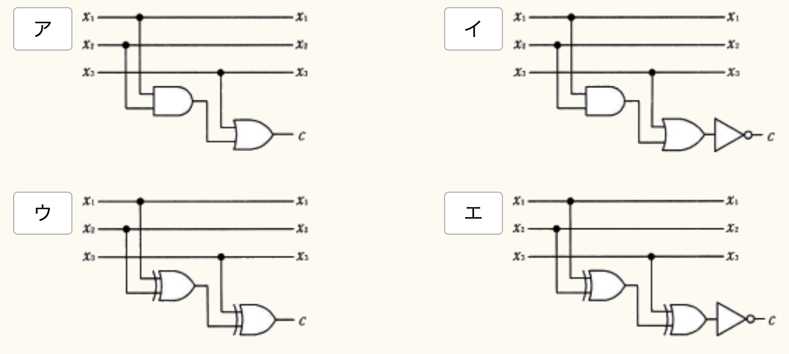

# パリティビット

## パリティビットとは？

1のビット数が指定した条件になるよう，末尾に加えられるビットのこと．
1のビット数を偶数にしたい場合は偶数パリティビット，奇数にしたい場合は奇数パリティビットという．

## 例題

3ビットのデータx1, x2, x3に偶数パリティビットcを付加する回路はどれか？

## 解説

一般的にビット列中の1の個数が奇数or偶数を確認する方法として，XOR演算のみが利用される．このことから，ア，イは除外される．実際に計算を行ってみると，ウが正解となる．エは奇数であるかを確認する場合に利用される回路図である．
